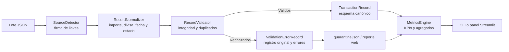

# Ficha técnica — Normalizador y auditor de transacciones multi-fuente

## 1. Descripción general

Aplicación ETL local escrita en Python para procesar lotes JSON de transacciones financieras provenientes de distintos proveedores. El sistema identifica la estructura de cada proveedor, transforma los datos a un esquema canónico, valida su integridad, separa los registros rechazados en una cuarentena y calcula métricas agregadas.

El proyecto ofrece dos formas de uso:

- **CLI:** procesa archivos JSON desde la terminal, genera el reporte de cuarentena y muestra métricas.
- **Interfaz web:** permite cargar un lote, explorar y filtrar registros válidos, consultar gráficos y descargar resultados desde Streamlit.

El procesamiento se realiza por lote y en memoria. No requiere una base de datos ni se conecta a servicios externos.

## 2. Objetivos y alcance

- Unificar estructuras de transacciones diferentes en un único esquema.
- Mantener las reglas de mapeo y normalización separadas del código en `transaction_normalizer/config/rules.json`.
- Conservar el registro original y los motivos de rechazo para facilitar auditorías.
- Calcular conteos y totales por estado, proveedor y divisa.
- Permitir la ejecución automatizada por CLI o el análisis interactivo mediante la interfaz web.

El proyecto no convierte importes entre divisas, no persiste resultados en una base de datos y no ofrece una API de servicio.

## 3. Arquitectura y flujo de procesamiento



### Etapas

1. **Lectura:** la entrada debe ser un archivo JSON cuyo elemento raíz sea una lista. Cada elemento que no sea un objeto se envía a cuarentena como estructura malformada.
2. **Detección de proveedor:** compara las llaves de cada objeto con las firmas configuradas. Intenta primero una coincidencia exacta y después busca perfiles cuyas llaves de firma estén contenidas en el registro.
3. **Normalización:** transforma importes a `Decimal`, normaliza las divisas y los estados, y convierte las fechas a UTC.
4. **Validación:** comprueba campos requeridos, montos positivos, divisas admitidas, estados reconocidos e identificadores no vacíos y únicos dentro del lote.
5. **Clasificación:** construye registros canónicos para los aceptados y conserva el dato original junto con los errores para los rechazados.
6. **Resultados:** exporta la cuarentena, opcionalmente los registros válidos, y calcula métricas para la salida de terminal o la interfaz.

## 4. Esquema canónico

| Campo | Tipo interno | Formato de salida | Descripción |
|---|---|---|---|
| `transaction_id` | `str` | Cadena | Identificador requerido, no vacío y único dentro del lote. |
| `source` | `str` | Cadena | Perfil de origen detectado (`provider_alpha`, `provider_beta` o `provider_gamma`). |
| `amount` | `Decimal` | Número JSON | Importe normalizado a la unidad principal de la divisa. Debe ser mayor que cero. |
| `currency` | `str` | Código en mayúsculas | Divisa admitida por la configuración (`USD`, `EUR` o `GBP`). |
| `timestamp` | `str` | `YYYY-MM-DDTHH:MM:SSZ` | Fecha y hora normalizadas a UTC. |
| `status` | `str` | `SUCCESS`, `FAILED` o `PENDING` | Estado normalizado al catálogo canónico. |

`Decimal` se utiliza durante el cálculo de importes para evitar operaciones monetarias con coma flotante binaria. Al generar JSON, los importes y métricas se convierten a números `float` por la serialización implementada.

## 5. Perfiles de entrada

Los perfiles se definen en `transaction_normalizer/config/rules.json`.

| Perfil | Llaves distintivas | Mapeo principal | Conversión del importe |
|---|---|---|---|
| `provider_alpha` | `id`, `amount`, `currency`, `timestamp`, `status` | `id` → identificador; campos restantes con el mismo nombre | Divisor `1` |
| `provider_beta` | `transaction_id`, `total`, `currency`, `created_at`, `state` | `transaction_id`, `total` → importe, `created_at` → fecha, `state` → estado | Divisor `100` |
| `provider_gamma` | `ref`, `amount`, `date`, `result` | `ref` → identificador, `date` → fecha, `result` → estado; divisa inferida del símbolo del importe | Divisor `1` |

La configuración también define los formatos de fecha aceptados por perfil, el catálogo de divisas, los símbolos monetarios (`$`, `€`, `£`) y los alias de estados. Las fechas sin zona horaria se interpretan como UTC; las fechas con offset se convierten a UTC.

Los formatos de importe admiten convenciones decimales anglosajonas y europeas, por ejemplo `1,250.50` y `1.250,50`. En el perfil Gamma, el símbolo monetario permite inferir la divisa cuando no existe un campo de moneda explícito.

### Alias de estado configurados

- **`SUCCESS`:** `completed`, `ok`, `success`, `succeeded`.
- **`FAILED`:** `failed`, `error`, `declined`, `rejected`.
- **`PENDING`:** `pending`, `processing`, `in_progress`.

## 6. Validaciones y cuarentena

Un registro se rechaza si no se identifica su proveedor o si presenta uno o más de estos problemas:

- Estructura que no es un objeto JSON o lote cuya raíz no es una lista.
- Identificador ausente o vacío.
- Monto ausente, con tipo o formato no admitido, no finito o menor o igual a cero.
- Divisa ausente o fuera del conjunto admitido.
- Fecha ausente, inválida o no compatible con los formatos definidos.
- Estado ausente o no incluido en el catálogo.
- Identificador duplicado respecto de un registro válido anterior del mismo lote.

Cada elemento de cuarentena incluye `raw_record`, `detected_source` y `errors`. Si el proveedor no puede detectarse, `detected_source` queda como `null`. Los elementos que no son objetos se representan bajo la llave `_raw_element`.

## 7. Métricas disponibles

`MetricsEngine` genera:

- Resumen con total procesado, cantidad válida e inválida y tasa de validez.
- Conteos de registros válidos por estado, proveedor y divisa.
- Importe total y monto de transacciones `SUCCESS`, agrupados por divisa.
- Frecuencia de motivos detectados en los registros en cuarentena.

Los totales se presentan por divisa; no se suman ni convierten importes de monedas distintas.

## 8. Estructura del proyecto

```text
transaction_normalizer/
├── config/
│   └── rules.json             # Perfiles, mapeos y catálogos
├── data/
│   ├── input_sample.json      # Lote de ejemplo
│   └── quarantine.json       # Salida de cuarentena de ejemplo/CLI
├── src/
│   ├── input_sample.json      # Copia adicional del lote de ejemplo
│   ├── __init__.py
│   ├── detector.py            # Identificación de proveedor
│   ├── metrics.py             # Métricas y agregaciones
│   ├── models.py              # Modelos canónicos y de error
│   ├── normalizer.py          # Normalización de valores
│   └── validator.py           # Validación y procesamiento por lote
├── tests/
│   ├── __init__.py
│   └── test_pipeline.py       # Pruebas unitarias
├── ui/
│   └── app.py                 # Aplicación Streamlit
├── main.py                    # Punto de entrada CLI
└── requeriments.txt           # Dependencias de la interfaz
```

## 9. Requisitos e instalación

Se requiere Python 3.10 o posterior para las anotaciones de tipos utilizadas. Las dependencias de interfaz declaradas son Streamlit y pandas.

Desde la carpeta del proyecto:

```bash
cd transaction_normalizer
python3 -m venv .venv
source .venv/bin/activate
pip install -r requeriments.txt
```

En Windows, activa el entorno con:

```powershell
.venv\Scripts\Activate.ps1
```

El archivo de dependencias del repositorio se llama `requeriments.txt`. El procesamiento CLI y las pruebas utilizan módulos de la biblioteca estándar de Python; Streamlit y pandas son necesarios para la interfaz web.

## 10. Ejecución

### CLI

Ejecuta desde `transaction_normalizer/`. Sin argumentos, el CLI utiliza `data/input_sample.json`, las reglas de `config/rules.json` y escribe la cuarentena en `data/quarantine.json`.

```bash
# Procesar con valores predeterminados
python3 main.py

# Indicar archivos y exportar registros válidos
python3 main.py \
  --input data/input_sample.json \
  --rules config/rules.json \
  --quarantine data/quarantine.json \
  --output-valid data/valid_output.json
```

Argumentos disponibles: `-i/--input`, `-r/--rules`, `-q/--quarantine` y `-o/--output-valid`. Las rutas proporcionadas se interpretan desde el directorio de trabajo actual. El archivo de cuarentena se crea o sobrescribe en cada ejecución; la exportación de válidos es opcional.

El CLI imprime las métricas, la cantidad de válidos y la ubicación de las salidas. Los errores de lectura de archivos, JSON inválido y payload con raíz incorrecta se informan en stderr y terminan con código de salida `1`.

### Interfaz Streamlit

```bash
streamlit run ui/app.py
```

La interfaz carga inicialmente el conjunto de ejemplo y permite sustituirlo por un archivo JSON. Presenta KPIs, gráficos de importes y estados, filtros por ID/proveedor/divisa/estado/fecha, una tabla de válidos y un reporte de cuarentena. Permite descargar los registros filtrados como CSV o JSON y la cuarentena como JSON. Las descargas de la interfaz no escriben archivos de salida en el proyecto.

## 11. Pruebas

Desde `transaction_normalizer/`:

```bash
python3 -m unittest discover -s tests -v
```

La suite comprueba, entre otros casos, formatos de importes europeos y anglosajones, normalización de offsets horarios, rechazo de fechas inválidas, deduplicación, valores booleanos/no finitos, estructuras malformadas, métricas y rechazo de payloads cuya raíz no sea una lista.

## 12. Consideraciones operativas y límites

- La deduplicación se aplica únicamente al lote actual y solo incorpora al conjunto de IDs vistos los registros que ya superaron las demás validaciones.
- La detección se basa en firmas estructurales de llaves; un perfil debe configurarse antes de procesar un nuevo formato de proveedor.
- La configuración declara `settings.default_timezone` y `settings.quarantine_invalid_records`, pero el flujo actual no consulta esos valores: las fechas sin zona se tratan como UTC y la cuarentena se genera en cada ejecución CLI.
- La salida canónica transforma `Decimal` a `float` al serializar JSON. Para cálculos posteriores que requieran conservar exactamente la representación decimal, se debe considerar este límite de salida.
- El archivo `data/quarantine.json` incluido es una muestra de resultado y puede ser reemplazado por la ejecución del CLI con valores predeterminados.

## 13. Uso de IA como herramienta de apoyo

Durante el desarrollo se utilizó IA generativa como apoyo iterativo para estructurar, auditar y validar el pipeline. Las decisiones y correcciones se revisaron sobre la implementación:

- Se separaron las reglas de proveedores (`config/rules.json`) de las etapas de detección, normalización y validación para evitar lógica acoplada a cada proveedor.
- Se priorizó `decimal.Decimal` para las operaciones monetarias internas.
- Se corrigió la interpretación de separadores decimales y de miles para valores como `1.250,50`.
- Se añadieron controles para valores booleanos (que en Python también son subtipos de `int`) y números no finitos.
- Se incorporaron validación de IDs duplicados, argumentos de CLI y pruebas para los casos principales.

La IA se empleó como apoyo; la integración, las decisiones finales y la verificación del comportamiento corresponden al desarrollo del proyecto.
